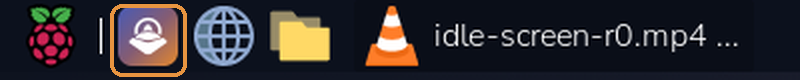
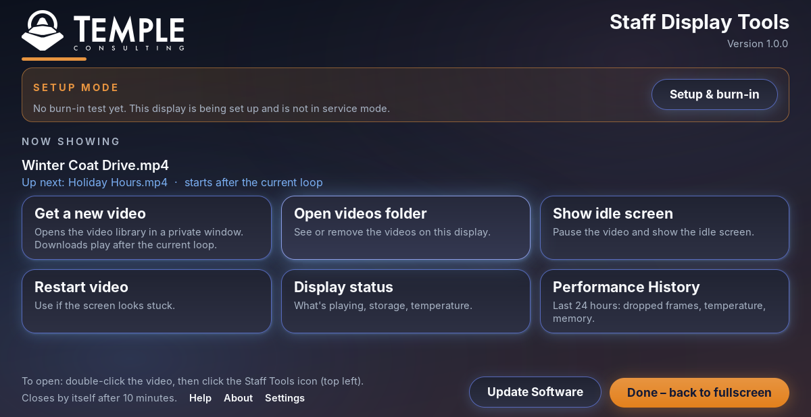

# Getting Started

What {{identity.displays_name}} do on their own, and how to open Staff Display Tools when you need them.

## What the Displays Do

The displays play their video on a loop by themselves. They start again after a power cut and keep playing when the internet is down. You only need Staff Display Tools to **change the video** or to **check a problem**.

Use the **mouse only**. Keyboard shortcuts are unreliable over Raspberry Pi Connect.

## Before You Start

1. Sign in to **Raspberry Pi Connect**.
2. Open **Screen sharing** for the display you want to work on.

A display whose TV is mounted sideways (portrait) shows its picture turned on your computer. That is normal.

## Open Staff Display Tools

1. **Double-click the video** to leave full screen. The taskbar appears at the top.
2. Click the **Staff Tools icon** at the top left of the taskbar, or double-click **{{identity.launcher_name}}** on the desktop.
3. Click a button **once**. It turns **yellow** and says what it is doing. Extra clicks are ignored, so wait for the message under the buttons.
4. When you finish, click **Done – back to fullscreen**.

While Staff Display Tools is open the video pauses, so it never covers the window or Help. It carries on when you click **Done** or the window closes. (During a burn-in test it keeps playing, in a window.)

The window closes by itself after 10 minutes without use, so it never stays on the public screen.

The **version** under the heading (for example "Version 0.6.0") opens **Release Notes**: what changed in each update, newest first.
