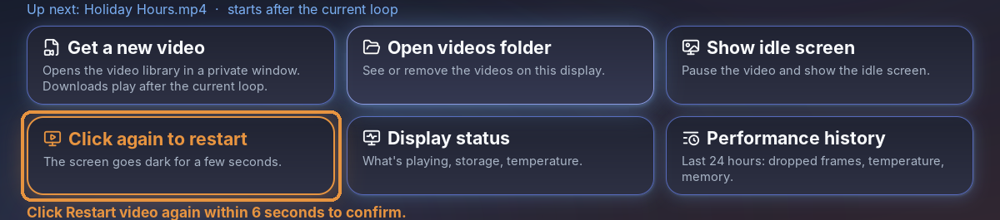
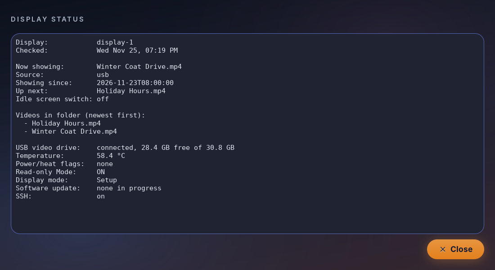

# The Buttons

What each Staff Display Tools button does and when to use it.

## Everyday Buttons

- **Get a new video** opens **{{content.library_name}}** in a private browser window. Downloads save straight to the display. Use it when a new video is approved.
- **Open videos folder** shows the videos stored on this display. You can delete one here.
- **Show idle screen** pauses the video and shows the idle screen. The button then reads **Resume video**; click it to bring the video back.
- **Restart video** restarts the video player when the picture is frozen, black or stuttering. Click it **twice within 6 seconds** to confirm. The screen goes dark for a few seconds.

## Checking the Display

- **Display status** shows what is playing and up next, free storage, temperature and whether Read-only Mode is on. Open it before you contact {{identity.contact}}.
- **Performance history** shows the last 24 hours of dropped frames, temperature and memory. Open it when you are asked to, or when the video has been stuttering.

## Updates and Setup

**Update Software**, **Setup & Burn-in** and **Settings** ask for the administrator password and change nothing without it. See [Updates and Setup](05-updates-and-setup.md).

## Warnings

Messages in yellow under **NOW SHOWING** are warnings. See [If Something Looks Wrong](04-troubleshooting.md).
