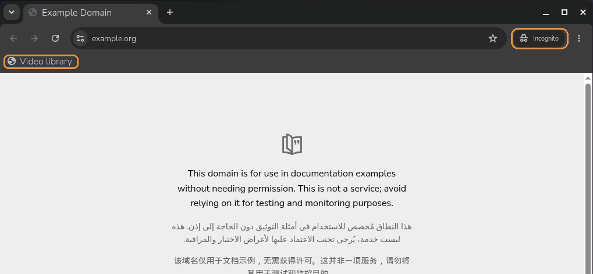

# Change the Video

From {{content.library_name}} to the screen, without cutting off the current ad.

## Prepare the Video

- Use an approved **MP4** at **1920 × 1080** from **{{content.library_name}}**.
- **A TV mounted on its side or upside down:** export the video already turned the way this display is set (**Settings > This display**). For 90° clockwise, the top of the portrait design sits at the **right edge** of the landscape frame; for 270°, at the left edge. The idle screen is turned for you.

## Steps

1. In Staff Display Tools, click **Get a new video**. The browser takes 10 to 20 seconds to open.
2. Sign in with your work account, open the video, and click **Download**. It saves straight to the display.
3. **Close the browser window** when the download finishes. Closing it signs you out.
4. Check **Up next** in Staff Display Tools. The new video starts when the current one finishes its loop, so nothing is cut off mid-ad.
5. Click **Start fullscreen playback**.

## Old Videos

The display keeps the three newest videos and removes older ones by itself. To remove one sooner, click **Open videos folder** and delete it.
