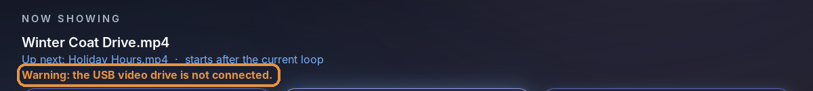

# If Something Looks Wrong

What to do about the most common display problems before you contact {{identity.contact}}.

## Picture Problems

- **Black or frozen picture:** click **Restart video** (twice). If it is still wrong, open **Display status** and contact {{identity.contact}}.
- **No picture after opening:** check the TV is on and set to the right HDMI input. The display keeps playing while the TV is off.
- **Idle screen instead of the video:** if the button reads **Resume video**, click it. If a yellow message says a **software update** is in progress, leave it until the update is finished.
- **The video player was closed:** it comes back by itself within a minute. To work on the desktop, double-click the video instead of closing it.
- **New video does not play:** wait for the current loop to end. In **Open videos folder**, check the file ends in **.mp4**. A name ending in **.crdownload** means the download did not finish.

## Yellow Warnings

- **“The USB video drive is not connected”:** the display plays its backup video. Do not unplug anything; contact {{identity.contact}}.
- **“Read-only mode is OFF”:** the display is not protected if the power goes out. Contact {{identity.contact}}.
- **“Software update in progress”:** the display is being updated. The video comes back when the update is finished.

## Good to Know

- The displays stay powered all the time. Turn the **TVs** off at closing and on at opening, but **never unplug a display**.
- **Read-only mode** protects each display from power cuts. Changes outside the videos are undone at every restart. Videos and history are kept.
- Questions or problems: contact **{{identity.contact}}**.
