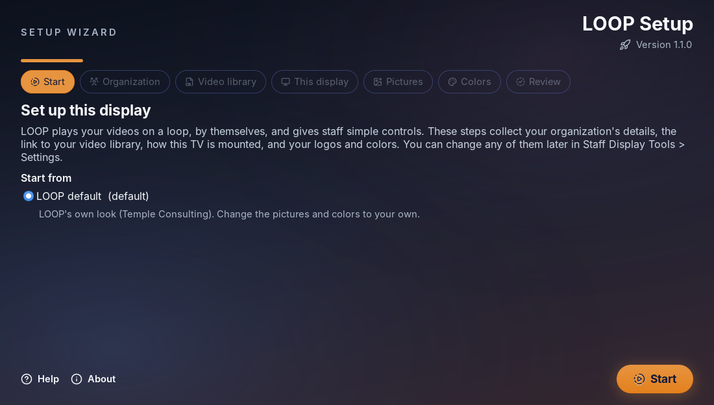
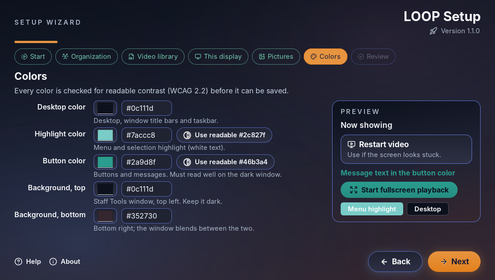
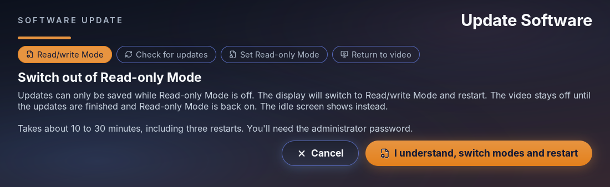
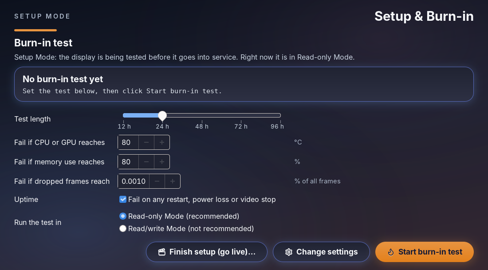
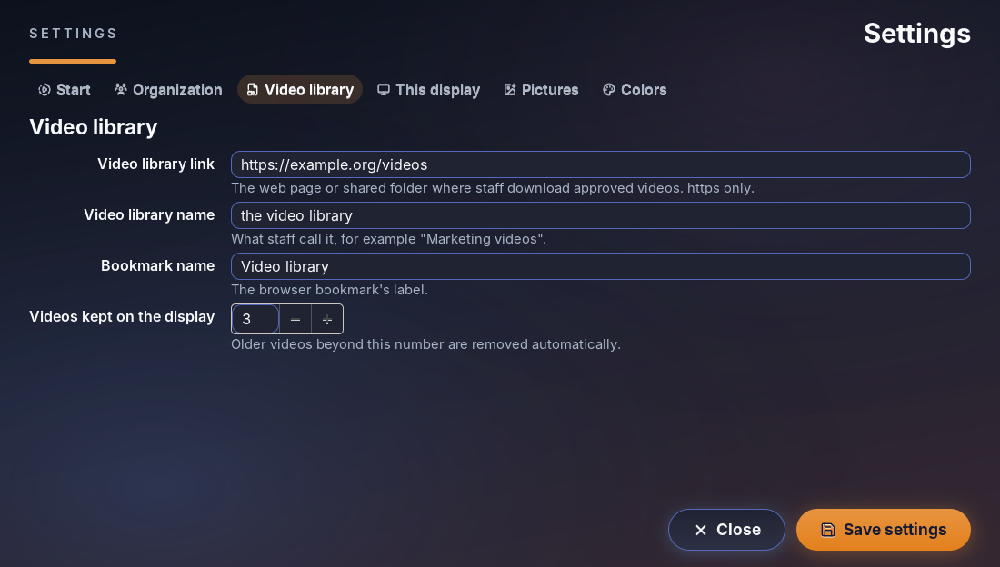

# Updates and Setup

First setup, settings, software updates, burn-in testing and going live. Every step that changes the display asks for the administrator password.

## First Setup

After LOOP is installed, **LOOP Setup** opens by itself at the next login (it is also in the Raspberry Pi menu under **Preferences**). It walks through seven steps: where to start from, your organization, the link to your video library, how this TV is mounted and which USB drive holds the videos, your pictures, your colors, and a final review. **Help** and **About** are at the bottom left of every step. Click a step at the top to go back to it, or forward to a step you have already completed; steps further on stay grey until the ones before them are done.

On the **Colors** step every color is checked for readable contrast. If one is too light or too dark, a **Use readable** button offers the nearest shade of the same color that passes; the preview shows the result.

## Update Software

Click **Update Software** next to **Start fullscreen playback** and follow the steps. The display switches to Read/write Mode and restarts, installs updates, restarts, then returns to Read-only Mode and restarts again. The video stays on the idle screen until Read-only Mode is back on.

- **Update all** is recommended. You can also choose groups: Raspberry Pi OS & security, VLC, Raspberry Pi Connect, or Chromium.
- If the window was closed, open Staff Display Tools again and click **Update Software** to continue from the same step.
- If the power went out during an install, the next start offers **Repair**.
- **Resume video without read-only** is not recommended: losing power in Read/write Mode can corrupt the storage card.

## Setup and Burn-in

A **SETUP MODE** banner means the display is still being tested. Click **Setup & Burn-in** to set the test length and limits, then **Start burn-in test**. The window shows progress, the highest readings and any failed check.

## Settings

Click **Settings** at the bottom of Staff Display Tools to change anything you chose in LOOP Setup: the organization details, the video library link, how this TV is mounted (0°, 90°, 180° or 270°), the logo, icon and idle screen pictures, and the colors. The tabs at the top switch between pages. **Start** changes the look you started from (LOOP's own or an organization's), and can also switch back to that look's pictures; **Open LOOP Setup** there runs the whole setup again, step by step. The **Colors** tab also sets the Staff Tools window's two-tone background. **Save settings** asks for the administrator password. Settings can only be saved while Read-only Mode is off: in Read-only Mode, Settings sends you to **Update Software**, which turns it off for you and offers **Change settings** once it is off.

## Going Live

When a test passes, click **Finish setup (go live)…**. It turns off SSH (recommended), turns on Read-only Mode, switches to Production Mode with 24 hours of Performance history, and restarts.

## Command Line

In the Pi Connect remote shell, **loop-maintenance status** shows the mode, update step and burn-in test, and **loop-maintenance burnin** prints the test report.
